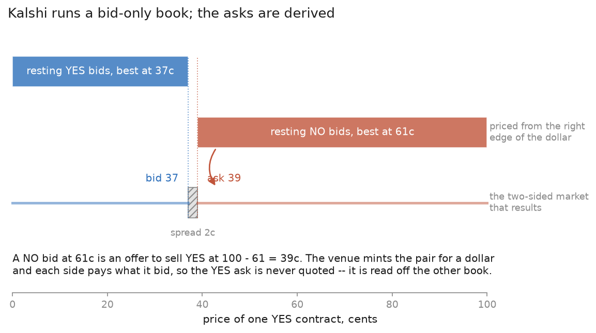
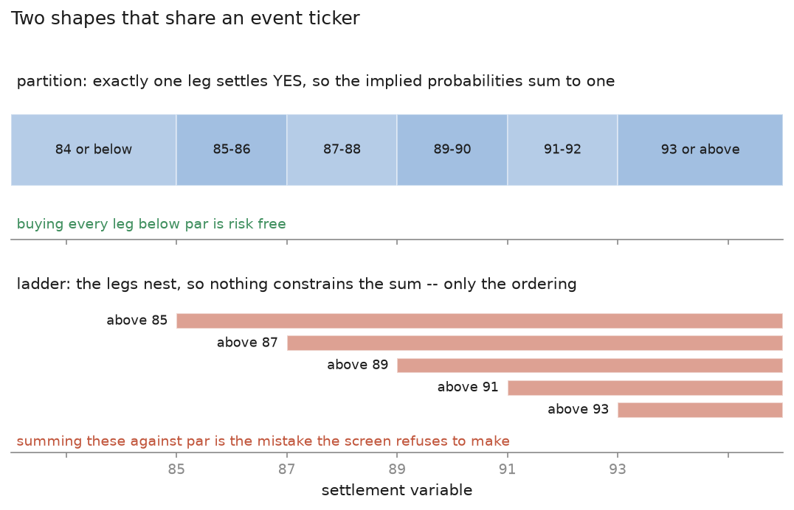
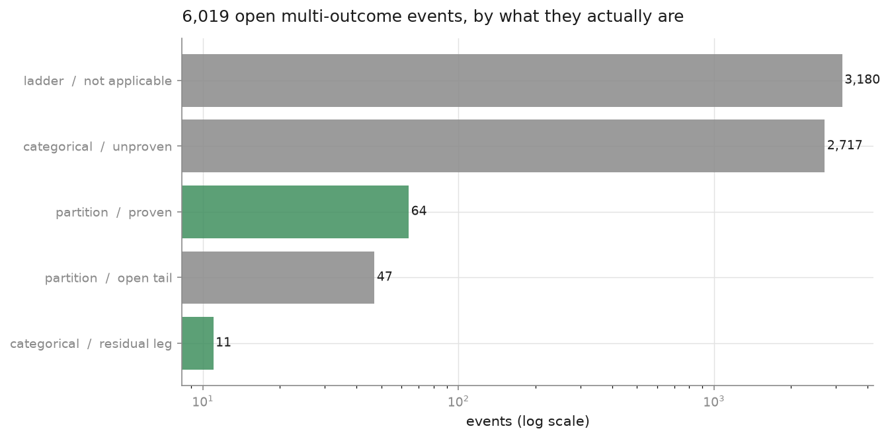
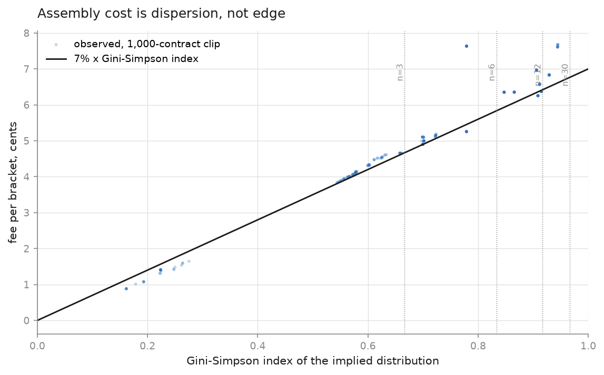
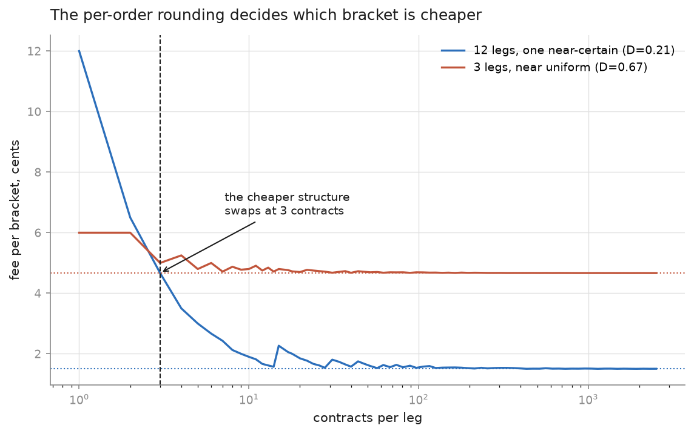
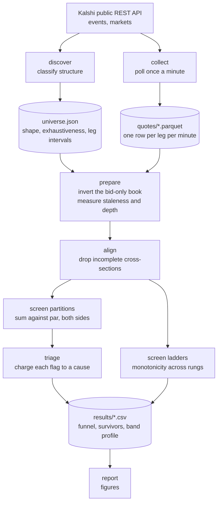

# Kalshi bracket pricing

Screening Kalshi's multi-outcome events for Dutch books, and finding out what
happens to them once the spread and the fee are paid for.

The idea is old and simple. If an event has outcomes that are mutually exclusive
and between them cover everything that can happen, then exactly one of them
settles at a dollar. Buy every leg for a total of less than a dollar and you have
locked in the difference no matter what happens. Kalshi lists hundreds of events
that look like that, the API is public, and the arithmetic is one line of pandas.

Run that one line and you get flags. Lots of them. This repository is about why
almost none of them are money, and the answer turns out to be more interesting
than the screen.

---

## Contents

- [What the venue actually quotes](#what-the-venue-actually-quotes)
- [Where the no-arbitrage band comes from](#where-the-no-arbitrage-band-comes-from)
- [Partitions, ladders, and what exhaustive means](#partitions-ladders-and-what-exhaustive-means)
- [What a bracket costs to assemble](#what-a-bracket-costs-to-assemble)
- [Results](#results)
- [How the pipeline fits together](#how-the-pipeline-fits-together)
- [Running it](#running-it)
- [Repository layout](#repository-layout)
- [Limitations](#limitations)

---

## What the venue actually quotes

The first thing to get right is that Kalshi does not run a two-sided book in the
way an equity venue does. Every resting order is a **bid**: either a bid for YES
contracts or a bid for NO contracts. There is no such thing as a resting offer on
the venue. What makes it tradeable anyway is the settlement identity

```
YES + NO = $1.00
```

which holds by construction, since exactly one of the two pays out. A resting bid
for NO at 61c is therefore economically identical to an offer to sell YES at 39c:
the taker hands over 39c, the venue mints the pair, and the NO bidder gets their
side at the price they bid.



So the ask you have to pay is never quoted. It is derived:

```
yes_ask = 100 - no_bid
no_ask  = 100 - yes_bid
```

and the quantity `100 - yes_bid - no_bid` is the slice of the dollar nobody is
currently bidding for, which is the market's full bid-ask spread. Half of it is
what a buyer pays away from mid.

Kalshi does publish `yes_ask` and `no_ask` as a convenience, and every collected
snapshot is checked against the derived values as a guard against the venue
quietly changing what its price fields mean. Over the sample they agree on every
quote where the opposite side of the book is non-empty. That check is two lines
and it is the difference between an analysis and a hope.

## Where the no-arbitrage band comes from

Write each leg's ask as its mid plus its half-spread, `a_i = m_i + s_i`, and each
bid as `b_i = m_i - s_i`. Then:

- Buying the whole bracket costs `sum a_i = sum m_i + sum s_i` and returns a
  dollar, so it wins only when `sum m_i < 100 - sum s_i`.
- Selling the whole bracket means buying one NO on every leg. Exactly one YES
  settles, so `n - 1` NO contracts pay a dollar each, and the profit reduces to
  `sum b_i - 100`. That wins only when `sum m_i > 100 + sum s_i`.

Together those bracket the mid sum inside

```
100 - sum(s_i)  <=  sum(m_i)  <=  100 + sum(s_i)
```

and nothing inside that band is tradeable at any size. **The half-width of the
band is the sum of the per-leg half-spreads**, so it is mechanically increasing
in the number of legs. A six-leg weather bracket quoted a penny wide on every leg
has a band three cents wide. A twenty-eight-leg crypto bracket quoted to exactly
the same standard has a band fourteen cents wide.

That is the single most important thing to hold on to when reading a raw flag.
The same apparent one-cent overround is deep outside the band on a two-leg market
and comfortably inside it on a thirty-leg one. An edge only means something next
to the band it has to clear, which is why the screen reports `band_ratio`
alongside every gross number.

## Partitions, ladders, and what exhaustive means

An event ticker on Kalshi is a grouping, not a claim. Two things routinely go
wrong if you take the grouping at face value.

**A ladder is not a partition.** "Bitcoin above 70,100", "above 70,200", "above
70,300" are nested, not disjoint. Several settle YES at once. Nothing constrains
them to sum to anything — the only constraint is that the sequence is monotone.
Summing a 188-leg ladder against par produces an apparent short-side edge in the
tens of dollars and means precisely nothing.



**Exclusive is not exhaustive.** The Dutch book is only risk free if some leg is
*certain* to pay. An event listing five candidates out of a field of nine is a
perfectly ordinary event, and buying all five below par is a bet that the winner
is in the group, not an arbitrage. Kalshi publishes a `mutually_exclusive` flag
and a `MECNET` collateral type, and both are read here, but neither answers this:
they are statements about margining, not about settlement.

So exhaustiveness is established from the settlement terms. For numeric brackets
that means checking the strike intervals tile the support of the settlement
variable with no gap and with both ends reached. Which turns out to need a model
of what values the settlement variable can take:

- New York temperature buckets run `84 or below`, `85-86`, `87-88`, `89-90`,
  `91-92`, `93 or above`. As intervals on the real line they leave 86.5
  uncovered. They tile only because the settlement source reports whole degrees.
- S&P brackets are written `4,199.99` then `4,200`. Those touch, because the
  index is published to the cent, and the `.99` convention exists to say so.

`infer_support` reads the grid from the rules text where it can and from the
precision of the strikes where it cannot — Kalshi writes strikes at the
resolution of the settlement source, so the decimal places on the strike grid
*are* the tick. Every verdict carries the evidence that produced it, so "proven"
is always readable as "proven under this stated assumption".

The test is deliberately strict, and it produces verdicts that look pedantic. A
Senate-seat bracket whose top leg is capped at 100 comes back `open_tail`,
because nothing in the rules text says the Senate has a hundred seats. That is
the right default: the alternative is a classifier that quietly smuggles outside
knowledge into a proof. Where the bound really is certain, `domain_bounds` in the
config supplies it and the evidence records that it came from configuration.

Running the classifier over the whole open board is itself informative:



The great majority of multi-outcome events on Kalshi are not objects you can sum.

Ladders are not useless, they are just not additive. What they do admit is a
monotonicity screen: the implied probability must fall as the threshold rises, so
if a higher rung can be *sold* for more than a lower rung *costs*, the pair is
guaranteed to return at least a dollar for less than a dollar. `screen_ladders`
checks adjacent rungs, which is complete — a violation between two distant rungs
implies one between some adjacent pair.

Details in [docs/structure.md](docs/structure.md).

## What a bracket costs to assemble

Kalshi's taker fee is quadratic in price:

```
fee = roundup_to_cent( rate * C * P * (1 - P) )
```

with `rate = 0.07` on the general schedule, `C` contracts and `P` in dollars. The
round-up applies **per order**, not per contract and not per fill.

Ignore the rounding and add that up over the legs of a partition:

```
total / C = rate * sum_i p_i (1 - p_i) = rate * ( 1 - sum_i p_i^2 ) = rate * D
```

because the implied probabilities of a partition sum to one. `D` is the
**Gini-Simpson index** of the implied distribution. So the cost of buying a whole
bracket does not depend on how much edge is on the table, and in a real sense not
on how many legs there are either. It depends on how *dispersed* the implied
distribution is.



A twenty-eight-leg crypto bracket with most of its mass on one bucket costs about
0.7c to assemble. A three-way coin flip costs 4.7c. And since `D` is maximised by
the uniform distribution at `1 - 1/n`, the cost is bounded by `rate` itself —
seven cents — however many legs are involved, which makes that a useful smell
test on any screen output.

Now put the rounding back. Each leg is a separate order, so each leg pays at
least one cent however small the position. A twelve-leg bracket costs at least
twelve cents on a one-contract order regardless of what the continuous term says.
The floor stops binding on a leg at about `1 / (rate * 100 * p * (1-p))`
contracts, which for a one-cent leg is around fourteen.

Since the floor scales with leg count and the continuous term scales with
dispersion, **which partition structure is cheaper reverses with order size**:



At one contract, the twelve-leg bracket pays its twelve-cent floor and the
three-leg one pays six. By three contracts the ranking has flipped and it never
flips back. That is why the screen prices every event-minute at several clip
sizes rather than picking one: a two-cent gross edge on a twenty-leg bracket is
money at a thousand contracts and a loss at ten.

Details and the full algebra in [docs/fees.md](docs/fees.md).

## Results

<!-- RESULTS -->

## How the pipeline fits together



Two details in there are doing more work than they look like they are.

`prepare` measures, for every leg at every minute, how long its two bid sides
have been unchanged — in wall-clock minutes, not in polls, so a gap in collection
counts as elapsed time. If the collector was not looking, we do not get to claim
the quote was fresh.

`align` throws away any event-minute whose leg set does not exactly match the leg
set the classifier signed off on. A poll that returns eleven of twelve legs
produces a cross-section that never existed, and summing it manufactures an
arbitrage out of a dropped HTTP request. The discarded minutes are counted rather
than silently dropped, because a high drop rate is itself a signal that an
event's legs are being listed and delisted underneath the screen.

## Running it

Python 3.10 or newer. No API key is needed: everything used here is on the public
market-data endpoints.

```bash
pip install -r requirements.txt
export PYTHONPATH=src
```

Classify the whole open board:

```bash
python -m brackets.cli board
```

Build the working universe from `config/universe.yaml`, then collect for a
couple of hours:

```bash
python -m brackets.cli discover
python -m brackets.cli -v collect --minutes 160
```

Screen the panel and draw the figures:

```bash
python -m brackets.cli screen
python -m brackets.cli report
```

A sample panel is committed under `data/sample/`, so the screen runs without
waiting on a collection window:

```bash
python -m brackets.cli screen --panel data/sample/quotes_sample.parquet --universe data/sample/universe.json
```

Tests:

```bash
python -m pytest -q
```

The suite covers the inversion identity, the fee arithmetic against Kalshi's own
published worked example, the classifier against hand-built partitions, ladders,
gaps and open tails, and the screen against a synthetic panel with a stale leg, a
thin offer and one genuine dislocation planted in known places.

## Repository layout

```
src/brackets/
  api.py          public REST client: pagination, retries, price normalisation
  book.py         bid-only to bid-ask inversion, spreads, executable asks
  structure.py    partition vs ladder, support models, exhaustiveness proofs
  fees.py         Kalshi's fee function, the Gini-Simpson identity, size effects
  collect.py      universe discovery and the minute-resolution poller
  panel.py        inversion, staleness, cross-section alignment, quoting quality
  screen.py       sum-against-par and ladder monotonicity screens
  diagnostics.py  charging each raw flag to a cause
  simulate.py     synthetic panel with planted artefacts, for the tests
  report.py       figures
  cli.py          board / discover / collect / screen / report
config/           universe and screen parameters
docs/             fee algebra, classification rules, figures
tests/            56 tests
```

## Limitations

Worth being explicit about, because several of these would change the numbers
rather than just the presentation.

- **Top of book only.** The panel records the best bid on each side and the size
  behind it. Assembling a bracket in real size walks the book, so the screen's
  execution assumption is optimistic exactly where it matters most.
- **Quotes, not fills.** Nothing here was traded. A flag that survives the screen
  is a flag that survived the screen; whether it would have filled at those
  prices is a different question and this repository does not answer it.
- **A short sample.** The panel is a few hours of a single afternoon. That is
  enough to characterise where flags come from and to demonstrate the band and
  fee arithmetic; it is not enough to say anything about how often a genuine
  dislocation appears.
- **Collateral is not modelled.** Buying every YES leg costs the ask sum up
  front. Selling the bracket means buying `n` NO contracts, which is a far larger
  outlay unless the venue nets it. Kalshi does net across mutually exclusive legs
  and the screen records the flag, but the capital cost is not priced.
- **The fee schedule is a moving target.** The 7% rate is the general schedule at
  the time of writing. Some series differ and some carry a maker fee. The rate is
  a parameter throughout, but any number here is worth re-checking against the
  published schedule.
- **Support inference is an assumption, not a proof.** Reading the settlement
  tick off the strike grid is a good rule and it is wrong somewhere. Every
  verdict carries its evidence for exactly that reason.

## Licence

MIT.
