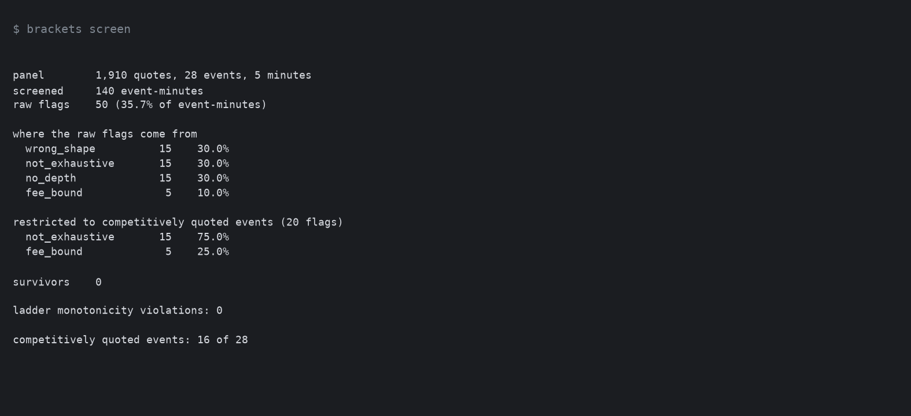
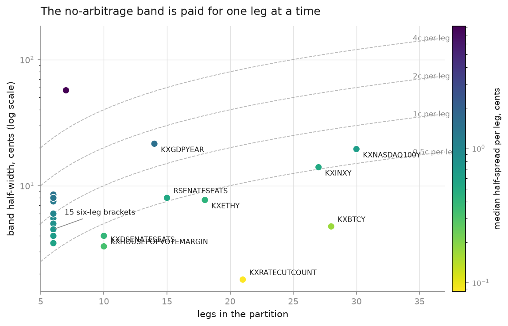
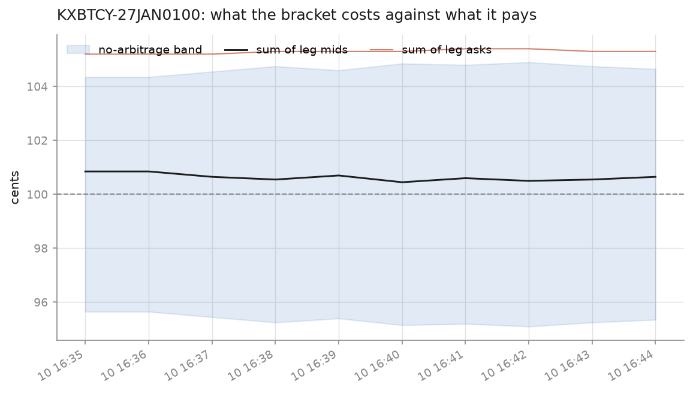
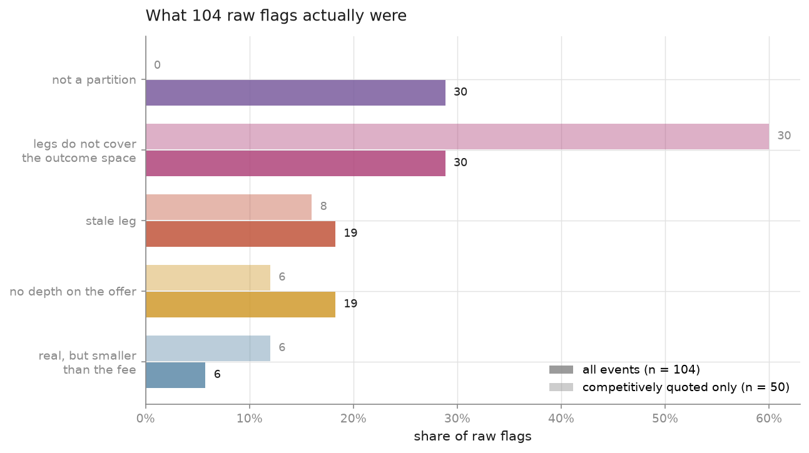
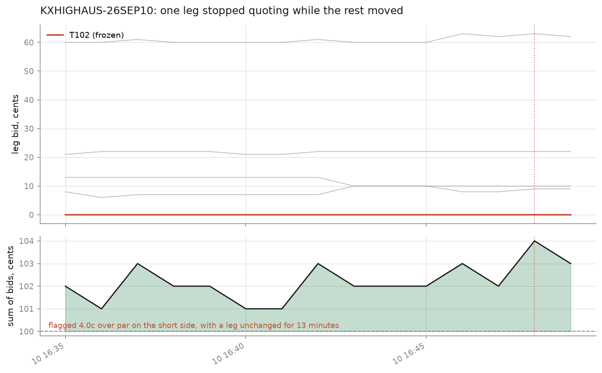
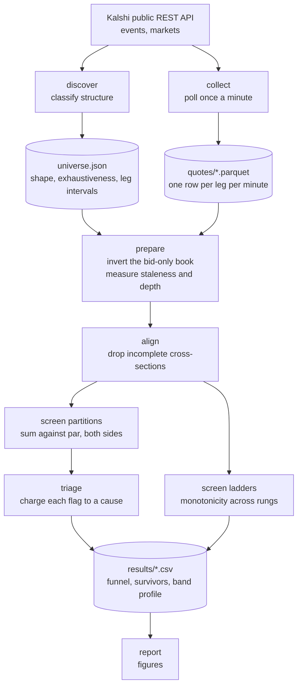
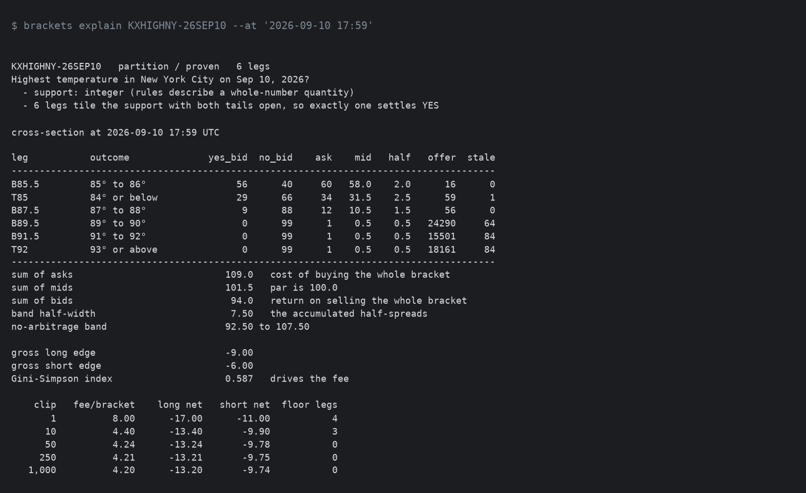

# Kalshi bracket pricing

Screening Kalshi's multi-outcome events for Dutch books, and finding out what
happens to them once the spread and the fee are paid for.

The idea is old and simple. If an event has outcomes that are mutually exclusive
and between them cover everything that can happen, then exactly one of them
settles at a dollar. Buy every leg for a total of less than a dollar and you have
locked in the difference no matter what happens. Kalshi lists hundreds of events
that look like that, the API is public, and the arithmetic is one line of pandas.

Run that one line and you get a lot of flags. This repository works through why
almost none of them are money.

---

## Contents

- [What the venue actually quotes](#what-the-venue-actually-quotes)
- [Where the no-arbitrage band comes from](#where-the-no-arbitrage-band-comes-from)
- [Partitions, ladders, and what exhaustive means](#partitions-ladders-and-what-exhaustive-means)
- [What a bracket costs to assemble](#what-a-bracket-costs-to-assemble)
- [Results](#results)
- [How the pipeline fits together](#how-the-pipeline-fits-together)
- [Running it](#running-it)
- [Repository layout](#repository-layout)
- [Limitations](#limitations)

---

## What the venue actually quotes

The first thing to get right is that Kalshi does not run a two-sided book in the
way an equity venue does. Every resting order is a bid: either a bid for YES
contracts or a bid for NO contracts. There is no such thing as a resting offer on
the venue. What makes it tradeable anyway is the settlement identity

```
YES + NO = $1.00
```

which holds by construction, since exactly one of the two pays out. A resting bid
for NO at 61c is therefore economically identical to an offer to sell YES at 39c:
the taker hands over 39c, the venue mints the pair, and the NO bidder gets their
side at the price they bid.


So the ask you have to pay is never quoted. It is derived:

```
yes_ask = 100 - no_bid
no_ask  = 100 - yes_bid
```

and the quantity `100 - yes_bid - no_bid` is the slice of the dollar nobody is
currently bidding for, which is the market's full bid-ask spread. Half of it is
what a buyer pays away from mid.

Kalshi does publish `yes_ask` and `no_ask` as a convenience, and every collected
snapshot is checked against the derived values (two lines of code) as a guard
against the venue quietly changing what its price fields mean. Over the sample
they agree on every quote where the opposite side of the book is non-empty.

## Where the no-arbitrage band comes from

Write each leg's ask as its mid plus its half-spread, `a_i = m_i + s_i`, and each
bid as `b_i = m_i - s_i`. Then:

- Buying the whole bracket costs `sum a_i = sum m_i + sum s_i` and returns a
  dollar, so it wins only when `sum m_i < 100 - sum s_i`.
- Selling the whole bracket means buying one NO on every leg. Exactly one YES
  settles, so `n - 1` NO contracts pay a dollar each, and the profit reduces to
  `sum b_i - 100`. That wins only when `sum m_i > 100 + sum s_i`.

Together those bracket the mid sum inside

```
100 - sum(s_i)  <=  sum(m_i)  <=  100 + sum(s_i)
```

and nothing inside that band is tradeable at any size. The half-width of the
band is the sum of the per-leg half-spreads, so it is mechanically increasing
in the number of legs. A six-leg weather bracket quoted a penny wide on every leg
has a band three cents wide. A twenty-eight-leg crypto bracket quoted to exactly
the same standard has a band fourteen cents wide.

This matters whenever a raw flag is read. The same apparent one-cent overround
is deep outside the band on a two-leg market and comfortably inside it on a
thirty-leg one. An edge has to be judged against the band it needs to clear, so
the screen reports `band_ratio`, the gross edge divided by the band, alongside
every gross number.

## Partitions, ladders, and what exhaustive means

An event ticker on Kalshi groups markets together without saying anything about
how they relate. Two things routinely go wrong if you take the grouping at face
value.

The first is treating a ladder as a partition. "Bitcoin above 70,100", "above
70,200" and "above 70,300" are nested rather than disjoint, so several settle YES
at once. Nothing constrains them to sum to anything; the only constraint is that
the sequence is monotone. Summing the eighty rungs of a Bitcoin ladder against
par produces an apparent short-side edge of about thirty dollars, which is
meaningless.


The second is assuming that legs which are mutually exclusive are also
exhaustive. The Dutch book is only risk free if some leg is *certain* to pay. An
event listing five candidates out of a field of nine is a perfectly ordinary
event, and buying all five below par is a bet that the winner is in the group.
Kalshi publishes a `mutually_exclusive` flag and a `MECNET` collateral type, and
both are read here, but neither settles the question, because both describe
margining rather than settlement.

So exhaustiveness is established from the settlement terms. For numeric brackets
that means checking the strike intervals tile the support of the settlement
variable with no gap and with both ends reached, and that in turn needs a model
of what values the settlement variable can take:

- New York temperature buckets run `84 or below`, `85-86`, `87-88`, `89-90`,
  `91-92`, `93 or above`. As intervals on the real line they leave 86.5
  uncovered. They tile only because the settlement source reports whole degrees.
- S&P brackets are written `4,199.99` then `4,200`. Those touch, because the
  index is published to the cent, and the `.99` convention exists to say so.

`infer_support` reads the grid from the rules text where it can and from the
precision of the strikes where it cannot. Kalshi writes strikes at the
resolution of the settlement source, so the number of decimal places on the
strike grid gives the tick. Every verdict carries the evidence that produced it,
so "proven" always means "proven under this stated assumption".

A lot rests on that assumption, so it is measured here rather than asserted.
`brackets board --strict-support` re-runs the census accepting only what the
rules text states: 64 partitions are proven by default and 30 under the strict
model. The other 34 are proven only because the strike grid was read as evidence
of the settlement tick. That is a good rule but not a contract term, and those 34
make up nearly half of the 73 events on the board that can be screened at all.

The test is deliberately strict, and it produces verdicts that look pedantic. A
Senate-seat bracket whose top leg is capped at 100 comes back `open_tail`,
because nothing in the rules text says the Senate has a hundred seats. That is
the right default, since the alternative is a classifier that quietly smuggles
outside knowledge into a proof. Where the bound really is certain, `domain_bounds`
in the config supplies it and the evidence records that it came from
configuration.

Run over the whole open board, the classifier finds that the great majority of
multi-outcome events on Kalshi cannot be summed against par at all:


Ladders cannot be summed, but they do admit a monotonicity screen. The implied
probability must fall as the threshold rises, so if a higher rung can be *sold*
for more than a lower rung *costs*, the pair is guaranteed to return at least a
dollar for less than a dollar. `screen_ladders` checks adjacent rungs only, which
is enough: a violation between two distant rungs implies one between some
adjacent pair.

Details in [docs/structure.md](docs/structure.md).

## What a bracket costs to assemble

Kalshi's taker fee is quadratic in price:

```
fee = roundup_to_cent( rate * C * P * (1 - P) )
```

with `rate = 0.07` on the general schedule, `C` contracts and `P` in dollars. The
round-up applies per order, not per contract and not per fill.

Ignore the rounding and add that up over the legs of a partition:

```
total / C = rate * sum_i p_i (1 - p_i) = rate * ( 1 - sum_i p_i^2 ) = rate * D
```

because the implied probabilities of a partition sum to one. `D` is the
Gini-Simpson index of the implied distribution. So the cost of buying a whole
bracket does not depend on how much edge is on the table, and depends on the
number of legs only indirectly. What drives it is how *dispersed* the implied
distribution is.


A twenty-eight-leg crypto bracket with most of its mass on one bucket costs about
0.7c to assemble. A three-way coin flip costs 4.7c. And since `D` is maximised by
the uniform distribution at `1 - 1/n`, the cost is bounded by `rate` itself
(seven cents) however many legs are involved, which makes that bound a useful
smell test on any screen output.

Now put the rounding back. Each leg is a separate order, so each leg pays at
least one cent however small the position. A twelve-leg bracket costs at least
twelve cents on a one-contract order regardless of what the continuous term says.
The floor stops binding on a leg at about `1 / (rate * 100 * p * (1-p))`
contracts, which for a one-cent leg is around fourteen.

Since the floor scales with leg count and the continuous term scales with
dispersion, which partition structure is cheaper reverses with order size:


The figure shows this for two brackets that were listed at the same time, a
twenty-one-leg one and a six-leg one, which swap places at five contracts. The
simpler pair in [docs/fees.md](docs/fees.md) behaves the same way: at one
contract, a twelve-leg bracket with eleven one-cent legs pays its twelve-cent
floor and a three-way coin flip pays six. By three contracts the ranking has
flipped and it never flips back. That is why the screen prices every event-minute
at several clip sizes rather than picking one: a two-cent gross edge on a
twenty-leg bracket is money at a thousand contracts and a loss at ten.

Details and the full algebra in [docs/fees.md](docs/fees.md).

## Results

The panel is 32,470 quotes: 382 legs across 28 events, polled once a minute for
85 minutes on the afternoon of 10 September 2026. The mix is deliberate. It has
fourteen six-leg temperature brackets (seven cities, two days each) quoted tight
and two-sided all day, seven large brackets on prices and indices running to
thirty legs, four partitions whose legs are disjoint but leave outcomes unlisted,
and three threshold ladders that are there to be excluded.

Two sanity checks come first, since everything downstream depends on them. The
derived asks were compared against Kalshi's own published asks on all 29,106
quotes with a non-empty opposite side, and none disagreed. None of the 2,380
event-minutes had to be dropped for an incomplete cross-section either: the
collector never returned a partial bracket, so no flag below is an artefact of a
dropped request.



### The band grows with leg count even as quoting improves

Grouping the partitions by size:

| legs | median band half-width | median half-spread per leg |
|---|---|---|
| 6–7 | 5.00c | 0.83c |
| 10–15 | 6.00c | 0.53c |
| 18–30 | 11.05c | 0.48c |

The largest brackets are quoted tighter per leg than the six-leg ones, at about
half the half-spread, and their no-arbitrage band is still more than twice as
wide, because the band is paid once per leg. A raw overround number says very
little on its own, which is why every flag is reported in units of its own band.



The band also behaves as it should. A proven partition's mid sum sits inside its
own band essentially all the time. A partition whose legs do not cover the
outcome space sits persistently outside it, which looks the same as an edge in
the arithmetic but is not a trade.



### 779 raw flags, none of them money

A structure-blind screen (sum the legs, compare to par, flag anything that
clears) fires on 779 of 2,380 event-minutes, or 32.7%. Each flag is charged to
the first cause that applies:



| cause | all events | competitively quoted only |
|---|---|---|
| not a partition (ladder) | 255 (32.7%) | — |
| legs do not cover the outcome space | 255 (32.7%) | 255 (56.8%) |
| stale leg | 244 (31.3%) | 181 (40.3%) |
| no depth on the trading side | 19 (2.4%) | 7 (1.6%) |
| real, but smaller than the fee | 6 (0.8%) | 6 (1.3%) |
| **survives** | **0** | **0** |

On the competitively quoted events, which are tight, deep and two-sided as a
matter of course (so a flag on one cannot be put down to a wide book), **97.1%**
of raw flags are a stale quote or a mis-assembled bracket. Nothing survived at
any of the five clip sizes.

Taking the largest flag of each kind, rather than counting them, gives the same
picture:

| cause | largest example | gross | band | × band |
|---|---|---|---|---|
| not a partition | KXBTCD-26SEP1017 | 3099c | 43.5c | 71.2 |
| legs do not cover | KXFOMCDISSENTCOUNT-26SEP | 5.0c | 5.0c | 1.0 |
| stale leg | KXHIGHAUS-26SEP10 | 5.0c | 5.0c | 1.0 |
| no depth | KXHIGHAUS-26SEP11 | 4.0c | 7.0c | 0.6 |
| smaller than the fee | KXGDPYEAR-34 | 2.0c | 21.5c | 0.1 |

The ladder stands apart from everything else. Summing eighty nested Bitcoin
thresholds against par shows an apparent $30.99 short-side edge, seventy-one
times its own band, on every one of the 85 minutes. That is a category error
rather than an edge, and it is the largest thing a naive screen would find. Once
the ladders are excluded, no flag of any kind clears its own band by more than a
factor of one.

Most of the flags, 571 of the 779, are on the short side. Nested ladders and
brackets missing a tail both make the bid sum look too high, and neither is a
trade.

### What staleness actually looks like

Some legs were stale for a long time: the worst had not moved either bid in 84
minutes, the entire sample. A clearer example is a leg that was quoting and then
stopped. Austin's 96–97° bucket sat pinned at a bid of 5c for 43 minutes while
the top leg of the same bracket swung between 55c and 63c and every other leg
re-priced around it. The bid sum crossed par repeatedly during the stretch.



### The one real dislocation, and what the fee did to it

Six event-minutes produced a gross edge that survived structure, staleness and
depth, and then died to the fee. The largest was `KXGDPYEAR-34`, a fourteen-leg
bracket on 2034 US real GDP growth: the whole bracket could be bought for 98c
against a dollar that one leg is certain to pay. That is a two-cent gross edge on
a bracket quoted with a 21.5-cent band, and all fourteen legs were deep enough to
fill.

It loses money at every size. The implied distribution has a Gini-Simpson index
of 0.91, about as dispersed as a fourteen-leg bracket can be, so the fee is
`7% × 0.91 = 6.4c` per bracket at scale and 14c at a single contract. The net
result is −4.25c at a thousand contracts and −12c at one.

The case sums up the project: the edge was real and the arithmetic was right, but
the bracket was dispersed enough that the fee came to about three times the edge.

### The ladders were internally consistent

There were no monotonicity violations across 85 minutes of three ladders,
including the eighty-rung Bitcoin ladder: a higher threshold never bid above a
lower threshold's ask. Whatever else is true of these books, the market makers
running them keep the ordering intact.

## How the pipeline fits together



Two of the steps need a word of explanation.

`prepare` measures, for every leg at every minute, how long its two bid sides
have been unchanged. The measure is in wall-clock minutes rather than polls, so a
gap in collection counts as elapsed time: a quote is not treated as fresh over a
stretch when the collector was not looking at it.

`align` throws away any event-minute whose leg set does not exactly match the leg
set the classifier signed off on. A poll that returns eleven of twelve legs
produces a cross-section that never existed, and summing it manufactures an
arbitrage out of a dropped HTTP request. The discarded minutes are counted rather
than silently dropped, because a high drop rate is itself a signal that an
event's legs are being listed and delisted underneath the screen.

## Running it

It needs Python 3.10 or newer and no API key, since everything used here is on
the public market-data endpoints.

```bash
pip install -r requirements.txt
export PYTHONPATH=src
```

Classify the whole open board:

```bash
python -m brackets.cli board
```

Build the working universe from `config/universe.yaml`, then collect for a
couple of hours:

```bash
python -m brackets.cli discover
python -m brackets.cli -v collect --minutes 160
```

Screen the panel and draw the figures:

```bash
python -m brackets.cli screen
python -m brackets.cli report
```

To see the arithmetic on a single bracket rather than the summary:

```bash
python -m brackets.cli explain KXHIGHNY-26SEP10
```



Most of the points above show up in this one cross-section.

Three of the six legs have no YES bid at all (nobody wants 89° or hotter in New
York in September), and two of those have not moved in 84 minutes, the whole
sample. They still show tens of thousands of contracts on the offer, which is
what a deep book on a leg nobody wants looks like.

The mids sum to 101.5 against a par of 100, and the band runs from 92.5 to
107.5, so the bracket is nowhere near either edge. Buying the whole thing costs
109c to receive a dollar; selling it returns 94c against the dollar you then owe.
Both sides lose by roughly the spread, which is the normal state of a fairly
quoted partition.

The fee columns show the size effect in isolation. At a single contract the fee
is 8c a bracket with four of the six legs paying the one-cent floor. By fifty
contracts the floor has stopped binding entirely, and by a thousand the fee has
settled at 4.20c.
The diversity identity predicts `7% × 0.587 = 4.11c`, and the remaining 2% is
the away-from-par correction: the ask sum here is 109c rather than 100c, and
[docs/fees.md](docs/fees.md) shows why that shifts the identity by exactly this
much. The correction moves the number slightly but does not affect the
conclusion.

A sample panel is committed under `data/sample/`, so the screen runs without
waiting on a collection window:

```bash
python -m brackets.cli screen --panel data/sample/quotes_sample.parquet --universe data/sample/universe.json
```

Tests:

```bash
python -m pytest -q
```

The suite covers the inversion identity, the fee arithmetic against Kalshi's own
published worked example, the classifier against hand-built partitions, ladders,
gaps and open tails, and the screen against a synthetic panel with a stale leg, a
thin offer and one genuine dislocation planted in known places.

## Repository layout

```
src/brackets/
  api.py          public REST client: pagination, retries, price normalisation
  book.py         bid-only to bid-ask inversion, spreads, executable asks
  structure.py    partition vs ladder, support models, exhaustiveness proofs
  fees.py         Kalshi's fee function, the Gini-Simpson identity, size effects
  collect.py      universe discovery and the minute-resolution poller
  panel.py        inversion, staleness, cross-section alignment, quoting quality
  screen.py       sum-against-par and ladder monotonicity screens
  diagnostics.py  charging each raw flag to a cause
  simulate.py     synthetic panel with planted artefacts, for the tests
  report.py       figures
  cli.py          board / discover / collect / screen / explain / report
config/           universe and screen parameters
docs/             fee algebra, classification rules, figures
tests/            58 tests
```

## Limitations

Several of these would change the numbers themselves, not only how they are
presented.

- The panel records only the top of the book: the best bid on each side and the
  size behind it. A clip larger than the top-of-book size would walk into worse
  prices that this data cannot see, so the execution assumption is optimistic
  exactly where it matters most. The 1,000-contract column should be read as an
  upper bound on what that size would achieve rather than as a quote.
- Nothing here was traded, so everything is measured on quotes rather than
  fills. Whether a flag that survives the screen would have filled at those
  prices is a separate question, and this repository does not answer it.
- The sample is short: eighty-five minutes of one afternoon, across 28 events.
  That is enough to characterise where flags come from and to demonstrate the
  band and fee arithmetic, both of which are structural. It is not enough to say
  how *often* a genuine dislocation appears, and the six fee-bound minutes are
  six observations rather than a rate.
- Collateral is not modelled. Buying every YES leg costs the ask sum up front.
  Selling the bracket means buying `n` NO contracts, which is a far larger outlay
  unless the venue nets it. Kalshi does net across mutually exclusive legs and
  the screen records the flag, but the capital cost is not priced.
- The fee schedule can change. The 7% rate is the general schedule at the time of
  writing; some series differ and some carry a maker fee. The rate is a parameter
  throughout, but any number here is worth re-checking against the published
  schedule.
- Support inference is an assumption. Reading the settlement tick off the strike
  grid is a good rule, but it will be wrong somewhere, which is why every verdict
  carries its evidence.

## Licence

MIT.
